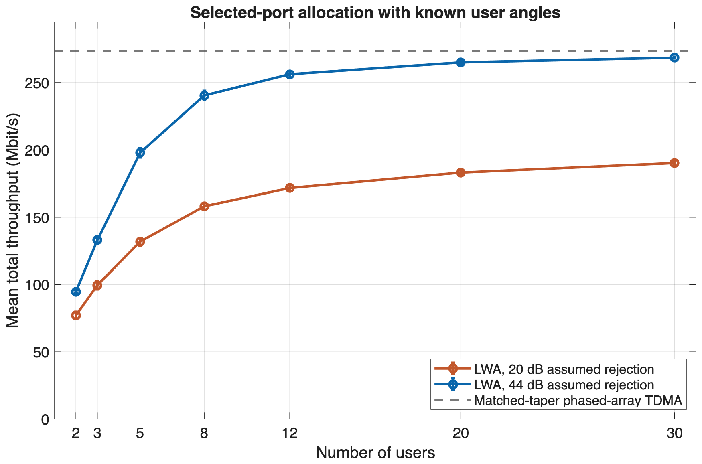
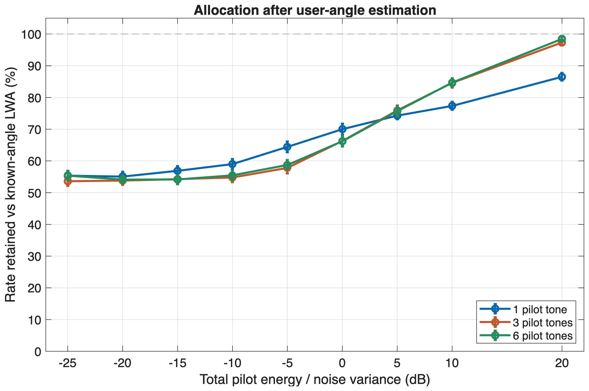

# Leaky-wave antenna frequency allocation

During my Mitacs Globalink research internship at the University of Manitoba, I built a MATLAB model of frequency allocation with a two-port leaky-wave antenna and studied the effect of pilot-based user-angle estimates.

## Research question

Can frequency-steered beams serve several users at once and approach the **total throughput** of a steerable phased array without per-element phase control?

The work is simulation-only. Here, sensing means **user-angle estimation**, not range estimation or a complete radar system.

## Two-port antenna model

The analytical antenna has 16 slots spaced 33 mm apart. Each slot extracts power from the guided wave. For either feed, directional gain is the squared magnitude of the complex slot-field sum, including guided and radiated phase. The left and right feeds give mirrored frequency-to-angle steering curves.

Six candidate bands have centres between 2.4 and 4.5 GHz but occupy only **20 MHz in total**; they are not contiguous. Each active band uses one selected feed. Simultaneous coherent excitation of both feeds was a separate extension, not the headline case.

## Interference-aware allocation

The scheduler maximizes modeled sum rate:

1. Each band is off, left-fed, or right-fed: $3^6-1=728$ nonempty configurations.
2. With $A$ active bands, each gets $P/A$ of the fixed total power. Candidate band-user rates include directional gain, per-band noise, and residual interference through the other bands' **selected feeds**.
3. MATLAB `matchpairs` assigns active bands to distinct users to maximize each configuration's rate sum. The scheduler keeps the best configuration, including the option to leave bands off.

Receiver rejection is modeled as a scalar power factor $10^{-I/10}$ at $I$ dB. The search is exact **within this selected-port, equal-power model**; it does not optimize per-band powers or establish measured receiver rejection.

## What the TDMA comparison means

The phased-array benchmark uses the **same element-amplitude taper** as the leaky-wave model. Phase shifters align its elements toward one user at a time. TDMA gives that user the full 20 MHz and total power during its turn; the leaky-wave system shares the same cumulative bandwidth and total power across simultaneous bands. This compares steering and resource sharing without changing the amplitude profile, but does not imply identical hardware or cost.

**Known-angle result:** In one modeled 30-user scenario, across 100 simulated user populations and with **44 dB assumed receiver rejection**, selected-port allocation reached **98.23% mean total throughput relative to the matched-taper phased-array TDMA reference** (268.57 versus 273.41 Mbit/s in the normalized model). The scheduler knew the true user angles. This is opportunistic sum throughput, not equal per-user service or a hardware measurement; in the tested sensitivity sweep, lower assumed rejection reduced throughput.



Mean total throughput with 95% confidence margins over 100 simulated user populations. Angles are known to the scheduler; 20 and 44 dB are assumed receiver-rejection settings, not measurements.

## Pilot-based angle estimation (separate experiment)

Users send known pilot tones; the receiver observes a complex response at **both feeds** per tone. A maximum-likelihood estimator compares these observations with predicted two-feed responses over candidate angles, fitting an unknown complex channel coefficient per tone. The one-, three-, and six-tone cases use the same *total* pilot energy.

Allocation uses **estimated** angles, but achieved rates are evaluated at **true** angles. This experiment is separate from the known-angle 98.23% result. No machine-learning model was used.



Mean of population-level rate-retention fractions with 95% confidence margins (100 simulated 30-user populations). The main unknown-channel-per-tone case assumes 44 dB receiver rejection and equal total pilot energy across the tone counts. At 20 dB pilot energy/noise, six tones retain 98.46% of the **known-angle LWA** rate, not 98.46% of TDMA.

## Code and runs

These are selected scripts from the final, consolidated MATLAB project, including refinements made while preparing the final report.

- `model/` contains the two-feed response, rate calculation, selected-port and coherent schedulers, assignment, and pilot-angle estimator.
- `experiments/geometry_study.m`, `convergence_study.m`, and `placement_study.m` explore the beam model, larger user populations, and pilot placement.
- `experiments/headline_study.m`, `fairness_study.m`, and `localization_study.m` run the reported communication, service, and angle-estimation comparisons.
- `tests/` contains physics checks, small exhaustive scheduling comparisons, and a grid-resolution check. The later localization/fairness follow-up and report-building utilities are not included.

In MATLAB R2026a, open this folder and run:

```matlab
run_tests
run_experiments(true)  % small smoke run
run_experiments        % full studies; substantially slower
plot_results           % after the full studies
plot_readme_figures    % regenerate the two README plots from the full results
```

The scripts write to ignored `results/` and `figures/` directories. The smoke run uses fewer populations and saves under `results/smoke/`; its numbers are not the report results. `matchpairs` is MATLAB's linear-assignment routine; it is not the Hungarian-method implementation. Octave compatibility has not been checked.
